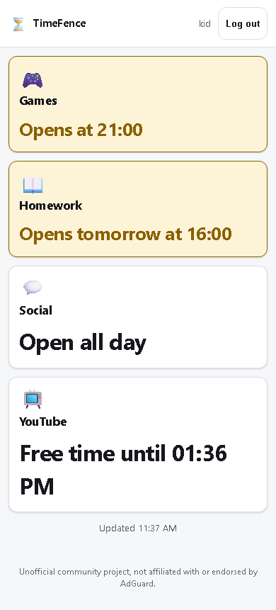
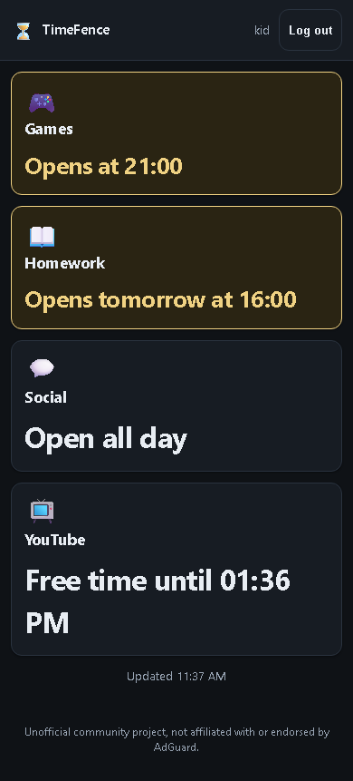
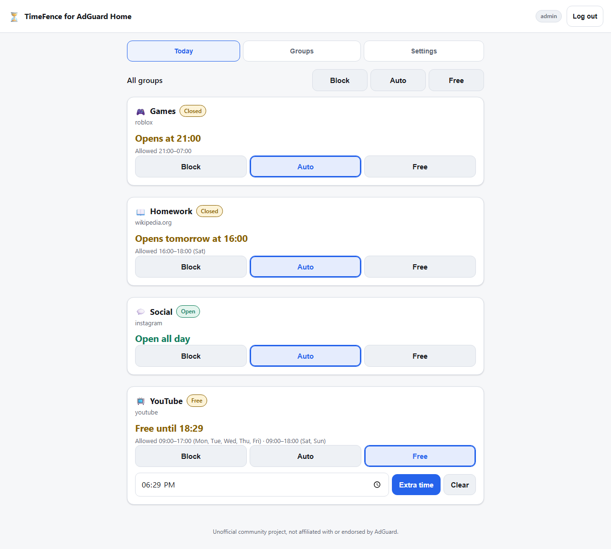
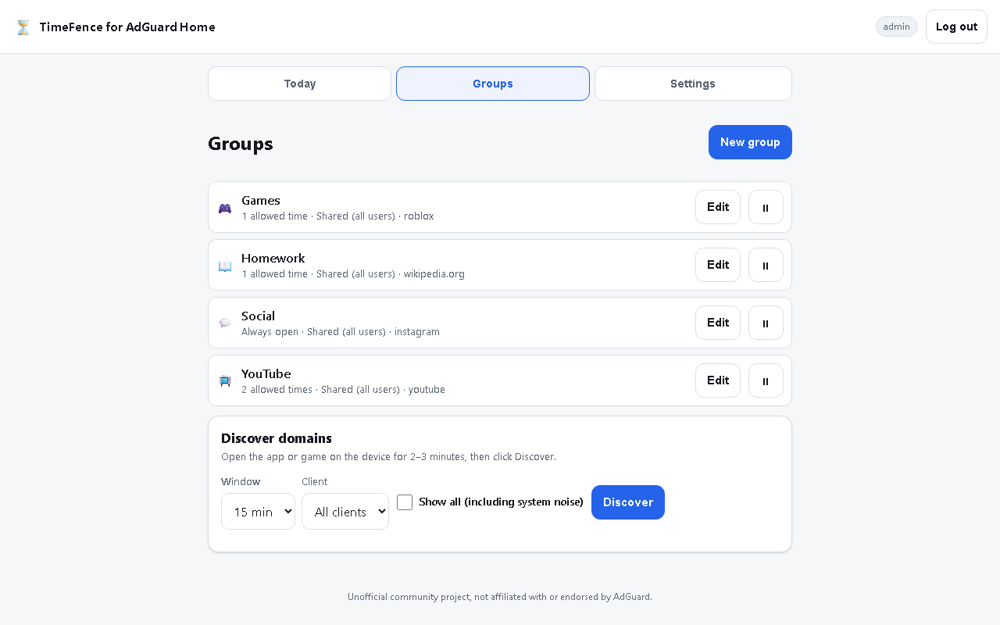
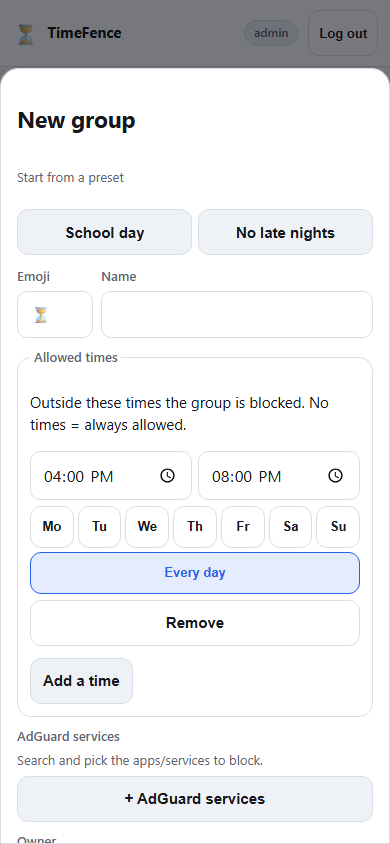
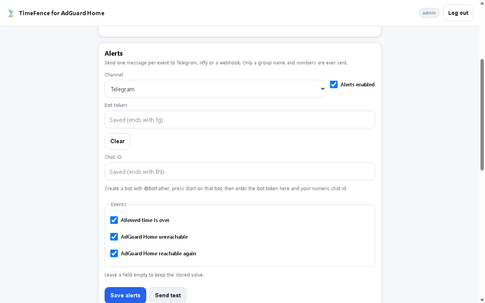

# TimeFence for AdGuard Home

**Allowed times for websites and apps, for AdGuard Home.**

TimeFence is a small companion app for [AdGuard Home](https://adguard.com/adguard-home/overview.html).
You group the apps and sites you want to ration (YouTube, Roblox, "the whole
Play Store"...) and give each group up to four **allowed times**: a start, an
end and the days it applies to (every day, weekdays or weekends). Inside those
times the group works normally; outside them TimeFence blocks it at the DNS
level, and the block lifts by itself when the next window opens. A group with
no windows is always open.

> **Unofficial community project, not affiliated with or endorsed by AdGuard.**

## Screenshots

Captured from the development server with sample data; the full set and how to
regenerate it are in [`docs/screenshots/`](docs/screenshots/).

| Kid view (phone) | Kid view (phone, dark) |
|---|---|
|  |  |









## Features

- **Unlimited groups.** Each group has a name, an emoji, 0–4 allowed times,
  any number of AdGuard *blocked services* and any number of custom domains.
- **Allowed times, not a stopwatch.** Nothing is metered and nothing counts
  down: a group is open inside its windows and blocked outside them, every day,
  with no daily limit to keep track of. Windows may cross midnight ("21:00 –
  07:00"), and the day filter belongs to the day the window starts on. No
  windows at all means the group is always open.
- **Read-only kid accounts with their own screen.** Admins manage everything; a
  `user` account sees only its own groups (plus shared ones) and gets one calm
  phone-first screen: "Open until 19:00", "Opens at 16:00", "Open all day" or
  "Blocked by a parent", never a countdown. It cannot change anything, and the
  server enforces that on every route.
- **Per-account groups.** A group can be owned by a user, so each child has
  their own schedule. Both roles use username + password (no PIN).
- **Easy overrides.** One `Block | Auto | Free` control per group on the Today
  card: `Auto` follows the allowed times, `Block` blocks now until local
  midnight, and `Free` asks until when and disables the windows for that long.
  The group list has a pause toggle, and a paused card keeps only Resume. Every
  action is applied once (double taps are ignored while in flight) and confirmed
  with a toast.
- **Alerts when it matters.** One Telegram bot, one ntfy topic or one webhook
  (no accounts, no third-party service): a message when a group's allowed time
  is over (off by default until you ask for it), and a warning when AdGuard
  Home stops answering plus a recovery message. Messages carry a group name and
  numbers only; de-duplication, one attempt per message (no retry) and an
  hourly cap of 20 keep them from turning into noise.
- **Reconciler** every 30 seconds: AdGuard is only written to when the desired
  state differs, and it preserves services/rules that TimeFence does not own.
- **Admin tools**: edit allowed times and targets, **Discover** recent domains
  from the AdGuard query log, a per-group rule **Test**, user management, and a
  password card that actually changes your own password.
- **Shared/critical-domain guard** with a plain-language warning
  ("Blocking apps.apple.com blocks the whole App Store, not one app.").
- **Accounts that end sessions.** Disabling, deleting, demoting or changing the
  password of an account signs its existing sessions out on the next request.
  Login is JSON-only, rate limited per account+address and per address, and
  always runs a hash so unknown users cannot be timed.
- **Honest health check** for container supervisors, and a safe shutdown that
  blocks every managed group (see [Fail-safety](docs/how-it-works.md#fail-safety)).
- Mobile-first UI, light/dark, no CDN, no frontend build step.

## Quick start

### Docker (built from the checkout)

```bash
git clone https://github.com/sbhas2k/timefence-adguardhome.git
cd timefence-adguardhome
printf 'your-adguard-admin-password' > adguard_password.txt   # or mount a secret
docker compose up -d
```

The example compose file runs `adguard/adguardhome` (host network, needs port
53) and TimeFence on `127.0.0.1:8099`; it reads the password from
`adguard_password.txt` below, so no `.env` file is involved. `.env.example` is
a reference for local runs: `uvicorn timefence.main:app` and `timefence run` read
the process environment (export the variables, or source a file in your shell);
`install.sh` writes `/etc/timefence/timefence.env` for the systemd service
instead.

### Script (systemd + venv)

```bash
git clone https://github.com/sbhas2k/timefence-adguardhome.git
cd timefence-adguardhome
sudo ./install.sh
# or, behind a reverse-proxy sub-path:
sudo BASE_PATH=/timer TZ=Asia/Kolkata ADGUARD_PASSWORD_FILE=/etc/timefence/adguard.pass ./install.sh
```

`install.sh` is idempotent. It creates the `timefence` system user, a venv in
`/opt/timefence`, `/var/lib/timefence`, `/etc/timefence/timefence.env` (600),
and the `timefence.service` unit.

### First login

> ⚠️ **A fresh install uses `admin` / `admin`.** That login lands on the
> first-run screen and forces a new admin password (at least 10 characters, not
> `admin`). Until setup is complete every other API call is rejected. The
> default login hint is only shown while setup is incomplete.

Accounts are username + password. Create one per child/family member in
**Settings → Users** and pick the role: `admin` (everything) or `user`
(read-only, own screen). A `user` password needs 8 characters, an `admin`
password 10.

Open `http://127.0.0.1:8099/` (or your reverse-proxied URL) and sign in.

## Configuration

Everything comes from environment variables (there is no `.env` loader).
`install.sh` writes `/etc/timefence/timefence.env` (mode 600) for the systemd
service; `.env.example` lists every variable.

| Variable | Default | Meaning |
|---|---|---|
| `ADGUARD_URL` | `http://127.0.0.1:3000` | AdGuard Home base URL |
| `ADGUARD_USER` | `admin` | AdGuard Home admin user |
| `ADGUARD_PASSWORD` | – | AdGuard Home password (inline) |
| `ADGUARD_PASSWORD_FILE` | – | File containing the password (wins over the inline value) |
| `BASE_PATH` | `/` | URL prefix the app is served under, e.g. `/timer` |
| `TZ` | *host timezone* | IANA timezone the allowed times are evaluated in (and the midnight "Block now" ends at); unset follows the host |
| `LISTEN_HOST` | `127.0.0.1` | Bind address (the image and `install.sh` keep it on loopback) |
| `LISTEN_PORT` | `8099` | Bind port |
| `DATA_DIR` | `/var/lib/timefence` | SQLite database + session secret (mode 0700 / 0600) |
| `TRUSTED_PROXIES` | *(empty)* | Comma separated CIDRs whose `X-Forwarded-For` is trusted |
| `RECONCILE_INTERVAL` | `30` | Seconds between reconciler passes (min 5) |
| `SECURE_COOKIES` | `true` | `false` only for plain-HTTP development |
| `LOG_LEVEL` | `INFO` | `DEBUG`/`INFO`/`WARNING`/`ERROR` |

`TZ` is optional. When it is not set, TimeFence reads the host's timezone
(`/etc/timezone`, then the real path of `/etc/localtime`) and only falls back to
UTC when neither is available; that fallback logs a warning and shows an admin
banner. Setting `TZ=UTC` explicitly, or a host whose system timezone is UTC, is
a choice and does not warn.

`timefence check` validates the configuration and prints the AdGuard connection
result without starting the web server.

## Adding a group

Admin → **Groups** → **New group**:

1. Name + emoji (e.g. `Games` 🎮).
2. Optionally add up to four **allowed times**: a start, an end, and whether
   they apply every day, on weekdays or at weekends. The day is the day the
   window starts on, and a window may cross midnight. No times = always open;
   the helper text says so in the editor.
3. Pick AdGuard **services** with the searchable picker (these are the official
   AdGuard "blocked services" ids), and/or paste **domains**, one per line.
   Pasted URLs are reduced to their hostname; each becomes `||domain^`, which
   also covers subdomains. A domain or service can belong to only one group.
4. Optionally assign an **owner** (a user account) so the group shows up on that
   child's screen.
5. If a domain is shared/critical (App Store, iCloud, Google, Akamai, ...),
   TimeFence asks for explicit confirmation and explains what else breaks.

Changes reach AdGuard Home within seconds and need no restart; on a device they
land as soon as its caches allow, see
[A block is not instant](#a-block-is-not-instant-allow-a-few-minutes).

### Finding a game's domains

Admin → **Groups** → **Discover**: open the game on the device for 2–3 minutes,
then click **Discover**. TimeFence groups the recent query-log hostnames by
registrable domain, hides OS/telemetry noise and already-managed domains, and
lets you tick domains and add them to a group. See
[docs/discover.md](docs/discover.md) for a worked example.

## Alerts (Telegram, ntfy or a webhook)

Settings → **Alerts** sends one message per event to a single channel: a
Telegram bot, an ntfy topic or a generic webhook. Only a group name, numbers and
a time are ever sent. Until a channel is set up, the Today tab shows a
dismissible reminder with a **Set up alerts** button that takes you straight to
the card.

### Telegram setup

1. In Telegram, message [@BotFather](https://t.me/BotFather), send
   `/newbot`, pick a name and a username ending in `bot`, and copy the token it
   prints (it looks like `123456789:AA…`).
2. Open your new bot and press **Start** — a bot cannot message you until you
   have started a conversation with it.
3. Message [@userinfobot](https://t.me/userinfobot); it replies with your
   numeric chat id (a negative number for a group).
4. In TimeFence: Settings → Alerts → Channel **Telegram**, paste the token and
   the chat id, press **Save alerts**, then **Send test**.
5. The saved token and chat id are never shown again — only their last two
   characters. Clear the token with the **Clear** button, or pick another
   channel; the old values stay stored but unused.

If the test fails with "Telegram rejected the bot token", the token was copied
wrong (or the bot was deleted). "Could not deliver" means the chat id is wrong
or you have not pressed **Start** on the bot yet.

### ntfy setup

1. Install the ntfy app (Android, iOS) or open the [ntfy web app](https://ntfy.sh/app).
2. Choose a topic name that is long and random — on the public `ntfy.sh`
   anyone who guesses a topic can read the messages. Something like
   `tf-kids-7s3k9x2q` rather than `timefence`.
3. Subscribe to that topic in the app.
4. In TimeFence: Settings → Alerts → Channel **ntfy**, leave the server as
   `https://ntfy.sh` (or your own ntfy server), enter the topic, press **Save
   alerts**, then **Send test**.
5. On a self-hosted ntfy that needs a login, also add an access token. The card
   warns you when the topic sits on a public server without a token.

## A block is not instant: allow a few minutes

TimeFence changes AdGuard Home within seconds (the buttons apply at once, and a
window opens or closes within one 30-second loop). The *device* then takes
longer to notice, **sometimes up to about five minutes**:

- **Cached answers.** AdGuard Home, the router, the phone or TV and the app all
  cache DNS answers until their lifetime (TTL) runs out. YouTube and other big
  services publish lifetimes of minutes.
- **Open connections.** A game session or live stream holds its connection and
  makes no DNS lookups at all, so a DNS change does not touch it until the app
  closes the connection or reconnects.

To make a block land sooner, fully close and reopen the app (or toggle Wi-Fi or
airplane mode on the device). TimeFence does **not** change any of AdGuard's DNS
settings; if you want shorter delays you can lower AdGuard's maximum cache TTL
yourself under *Settings → DNS settings*, at the price of more DNS queries. The
same delay applies when a group opens again.

## Running on a remote VM

TimeFence can serve a home network from a VM with a public address. Only DNS
(port 53, TCP and UDP) should be reachable from the internet, only from the home
connection, and the home address changes with consumer ISPs. The full guide —
firewall rules, an SSH tunnel for the UI, and a helper that re-resolves a DDNS
name every five minutes — is in [docs/remote-vm.md](docs/remote-vm.md); the order to do it in is
[docs/vm-deploy.md](docs/vm-deploy.md).

## Recovering access

If the admin password is lost or a sign-in is refused, set a new one from the
server. The password itself is never echoed, and the service can keep running:

```bash
sudo runuser -u timefence -- /opt/timefence/venv/bin/timefence passwd --role admin
```

(`timefence` is a system account without a shell, so `sudo -u` does not work;
`runuser` does. `--data-dir` defaults to `$DATA_DIR` or `/var/lib/timefence`.)

Add `--username NAME` to reset another account (`--role admin|user`). Rules:
admin password ≥ 10 characters and not `admin`; user password ≥ 8 characters.
Changing a password signs that account out everywhere.

Sign-in failures are counted per account+address (5 in 15 minutes) and per
address (20 in 15 minutes). The counters are held in memory, so
`sudo systemctl restart timefence` clears them immediately.

`timefence release` removes TimeFence's blocks from AdGuard Home (the managed
rules section and the services it took over) while keeping everything else. A
clean stop of TimeFence blocks every managed group, so use `release` whenever
you stop TimeFence on purpose — for example before `uninstall.sh`, which calls
it for you:

```bash
docker compose stop timefence && \
  docker compose run --rm --no-deps --entrypoint timefence timefence release
```

Stopping the container blocks all TimeFence groups by design (see
[fail-safety](docs/how-it-works.md#fail-safety)); starting it again returns to
the schedule, and `release` lifts the blocks while it stays stopped.

## Documentation

- [How it works](docs/how-it-works.md) — the schedule, reconciler, ownership, fail-safety
- [Reverse proxy](docs/reverse-proxy.md) — nginx (root and sub-path), Caddy
- [Limitations](docs/limitations.md) — what DNS-level time limits cannot do
- [Troubleshooting](docs/troubleshooting.md) — a device that is still not blocked
- [Discover workflow](docs/discover.md) — worked example
- [Backup & restore](docs/backup-restore.md)
- [Upgrading](docs/upgrading.md)
- [Running in Docker](docs/docker.md)
- [Deploy on a VM, step by step](docs/vm-deploy.md) — AdGuard Home + TimeFence on a VM for a home network, with DDNS
- [Running on a remote VM](docs/remote-vm.md) — firewall rules, the DDNS allow-list helper, recovery

## FAQ

**Does this work without AdGuard Home?** No, it drives AdGuard's API.

**Does it need the AdGuard Home add-on/Pro?** No, the free AdGuard Home has the
control API it uses.

**Does it count how long a site is used?** No. TimeFence keeps a schedule, not
a stopwatch: the group is open inside its allowed times and blocked outside
them, whatever happens in between. A stream or a game that is already running
may keep going until it reconnects and has to look a name up again, and a device
that bypasses your DNS (DoH, a VPN, mobile data) is not blocked at all — see
[limitations](docs/limitations.md).

**I forgot the admin password.** See [Recovering access](#recovering-access).

**A device is still not blocked although the allowed time is over.** Almost
always a DNS bypass — usually IPv6, sometimes an app's own resolver. See
[Troubleshooting](docs/troubleshooting.md).

**Why are my changes to AdGuard's user rules not visible?** TimeFence owns only
the `# timefence:begin … # timefence:end` block and the services belonging to
its groups. Everything else is preserved verbatim.

**Can different devices have different allowed times?** Not yet — windows are
per group/account, not per device. Give each child their own group (owned by
their account) for a per-child schedule.

**Do I need HTTPS?** For anything but localhost, yes: session cookies are
`Secure` by default. Put it behind nginx/Caddy. On a plain-HTTP LAN the login
page says so and sign-in will appear to fail unless you set
`SECURE_COOKIES=false` (development only).

**How do I add a second child?** Create a second `user` account and one group
per child, owned by that account. Each child signs in and sees only their
groups.

**Can I run it on a server with a changing home IP?** Yes — see
[Running on a remote VM](docs/remote-vm.md).

**Where do I ask for help or report a bug?** Open an issue on
[GitHub](https://github.com/sbhas2k/timefence-adguardhome/issues). Report a
security problem privately as described in [SECURITY.md](SECURITY.md), not in a
public issue.

## Roadmap

- Per-device rules (a schedule per client address rather than per group)
- YouTube restricted mode as an alternative to blocking
- Pi-hole support
- Multiple AdGuard instances
- Translations (the UI strings already live in `src/timefence/i18n.py`)

## Development

```bash
python3 -m venv .venv && . .venv/bin/activate
pip install -e ".[dev]"
pytest
ruff check src tests scripts && ruff format --check src tests scripts
```

The runtime dependencies are pinned in `requirements.lock` (with hashes); the
image installs from it. See [CONTRIBUTING.md](CONTRIBUTING.md) and
[SECURITY.md](SECURITY.md).

Deploying from a checkout on the host (no CI): `sudo -E ./deploy/update.sh`
(rollback: `--rollback <version>`), see [docs/upgrading.md](docs/upgrading.md).

## License

MIT — see [LICENSE](LICENSE). The bundled Public Suffix List
(`src/timefence/data/public_suffix_list.dat`) is MPL-2.0, see
`src/timefence/data/NOTICE`.

Unofficial community project, not affiliated with or endorsed by AdGuard.
